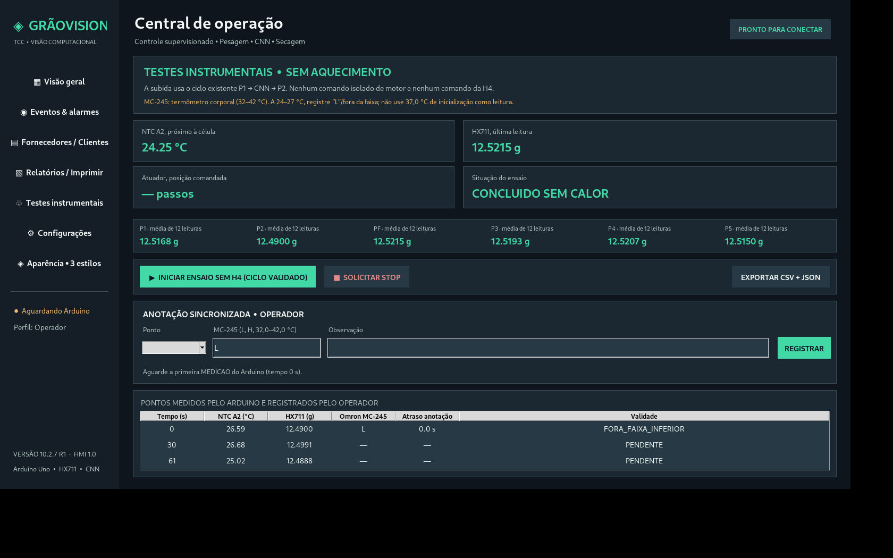
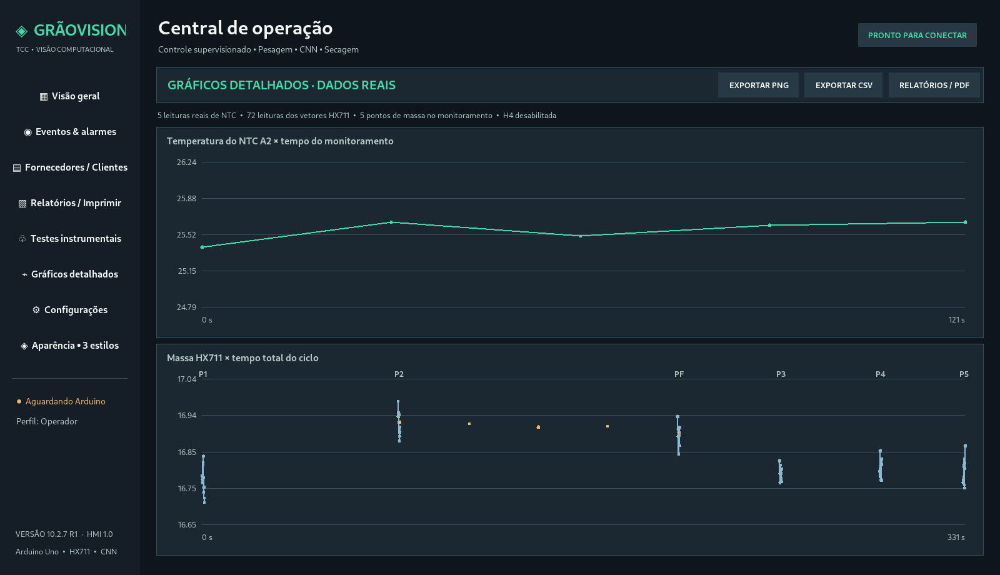
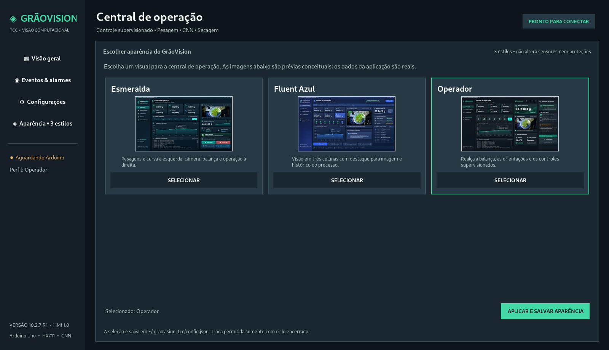

# GrãoVision — Registro visual da interface e dos ensaios

> **Natureza das evidências:** capturas de tela históricas da aplicação GrãoVision. São úteis para demonstrar interfaces e funcionalidades apresentadas nas versões do protótipo. Os números exibidos nas capturas **não foram auditados contra arquivos brutos de medição** neste pacote. Não são prova independente de precisão, calibração, classificação correta ou desempenho do equipamento.

## Ensaio instrumental sem aquecimento

Captura do módulo de testes instrumentais da interface GrãoVision. A tela identifica explicitamente um **ensaio sem aquecimento**, exibe campos de temperatura do NTC e massa lida pelo HX711, e apresenta pontos do ciclo de medição. As informações da imagem devem ser confrontadas com o log ou exportação original do ensaio antes de serem descritas como medições validadas.

## Gráficos de instrumentação

Captura da interface de visualização de séries de temperatura e massa. O gráfico ilustra a proposta de rastreabilidade das leituras e dos pontos do ciclo. Os títulos e rótulos mostrados na imagem refletem o estado da interface capturada, não uma avaliação independente da qualidade metrológica do equipamento.

## Interface gráfica: seleção de aparência

Captura do seletor de aparência do aplicativo. Demonstra o desenvolvimento da interface gráfica de operação; **não é um resultado de classificação de grãos**.

## Evidências ainda necessárias

- Foto da bancada física, com autorização para publicação e sem informações pessoais em etiquetas ou no ambiente.
- Exemplo de imagem capturada pela webcam e respectiva saída da CNN/Roboflow, com origem, classe, versão e critérios de avaliação.
- Logs brutos de um ensaio selecionado, identificando data, firmware, sensor, condições e limitações da instrumentação.
- Quando disponíveis, resultados de calibração e comparação com referência, indicando erro e repetibilidade.

**Recomendação:** publicar resultados numéricos somente após relacioná-los aos registros originais e separar claramente ensaios reais, dados sintéticos e capturas de interface.
